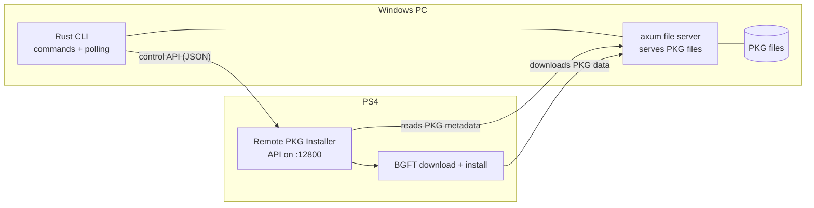

# PS4 Remote PKG Installer CLI

A Windows command-line client for [flatz's PS4 Remote PKG Installer](https://github.com/flatz/ps4_remote_pkg_installer).

Looking for the original Java GUI? It is available in the [PS4 Remote PKG Installer repository](https://github.com/BenjaminFaal/ps4-remote-pkg-installer).

## Build

Install Rust from [rustup.rs](https://rustup.rs/), then build the client from the repository root:

```powershell
cargo build --release
```

## Usage

Pass the console host with `--console`:

```powershell
.\target\release\ps4-remote-pkg-installer-cli.exe --console 192.168.1.50 status
.\target\release\ps4-remote-pkg-installer-cli.exe --console 192.168.1.50 install .\game.pkg
.\target\release\ps4-remote-pkg-installer-cli.exe --console 192.168.1.50 install-url https://example.com/game.pkg
.\target\release\ps4-remote-pkg-installer-cli.exe --console 192.168.1.50 tasks
```

For local installs, the CLI serves the selected files over HTTP while the task is running. Allow inbound connections to the configured file-server port (default `8080`) in Windows Firewall, and use `--advertise-ip` if automatic interface selection does not choose an address reachable by the PS4. Task IDs are stored under `%APPDATA%\ps4-remote-pkg-installer-cli`

## Tasks

Each install creates a task on the console. The CLI saves the task ID to `%APPDATA%\ps4-remote-pkg-installer-cli\tasks.json`, so you can check on it later from a new terminal.

```powershell
.\ps4-remote-pkg-installer-cli.exe --console 192.168.1.50 tasks
.\ps4-remote-pkg-installer-cli.exe --console 192.168.1.50 pause 12
.\ps4-remote-pkg-installer-cli.exe --console 192.168.1.50 resume 12
.\ps4-remote-pkg-installer-cli.exe --console 192.168.1.50 stop 12
.\ps4-remote-pkg-installer-cli.exe --console 192.168.1.50 remove 12
```

| Command | Description |
| --- | --- |
| `tasks` | Lists the tracked tasks as `ID`, `status`, `transferred/length`. Sizes are shown as KiB/MiB/GiB; add `--raw` for exact byte counts. |
| `pause <id>` | Pauses the task. |
| `resume <id>` | Resumes a paused task. |
| `stop <id>` | Stops the task. |
| `remove <id>` | Unregisters the task on the console and stops tracking it. |

Status values are `Downloading`, `Installing`, `Installed`, `Paused`, `Stopped` and `Unknown` (an unrecognised console state).

Notes:

- `tasks` lists only tasks started by this CLI, on this PC. Tasks created by other tools are not shown.
- `install` stays running and prints progress until the task reaches `Installed` or `Stopped`. For local files the file server runs only during this time, so do not close the window or the PS4 can no longer download the PKG. If you interrupt it, start the install again.
- Sizes are shown in KiB/MiB/GiB. Use `--raw` with `tasks` or `install` to show the exact byte counts as the console reports them, which can be in hex (for example `0x1F400000`).
- `install-url` and `install-manifest` return as soon as the task starts. Use `tasks` to follow progress.

## Architecture

The PS4 can only install from an `http://` or `https://` URL, so for local files the CLI runs a temporary HTTP file server (`axum` with `tower-http`) that the console downloads from. The server stops when the task finishes. `install-url`, `install-manifest` and the task commands do not use it.



```mermaid
sequenceDiagram
    participant CLI as Rust CLI
    participant FS as File server (PC :8080)
    participant API as PS4 installer (:12800)
    participant BGFT as PS4 BGFT

    CLI->>FS: Start serving PKG files at /pkg/&lt;token&gt;
    CLI->>API: POST /api/install (packages: http://PC:8080/pkg/...)
    API->>FS: Range requests (PKG header, param.sfo, icon)
    FS-->>API: 206 partial content
    API->>BGFT: Register download task
    BGFT->>FS: Range requests for PKG data
    FS-->>BGFT: 206 file chunks
    API-->>CLI: task_id
    loop until finished
        CLI->>API: POST /api/get_task_progress
        API-->>CLI: status, transferred, length
    end
    CLI->>FS: Stop file server
```
